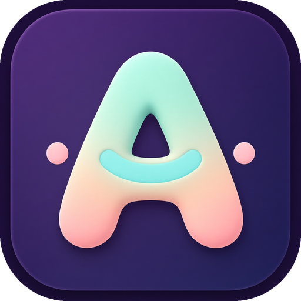
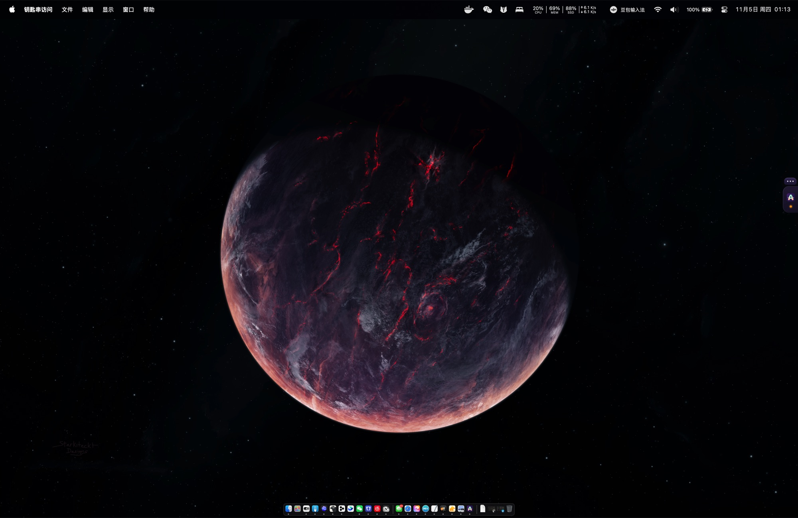
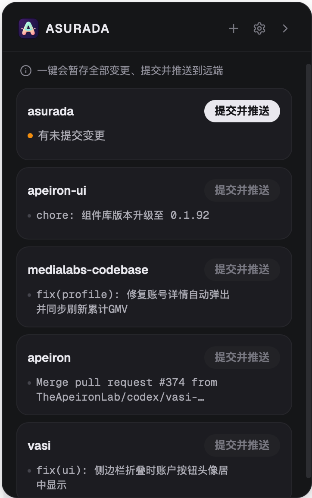
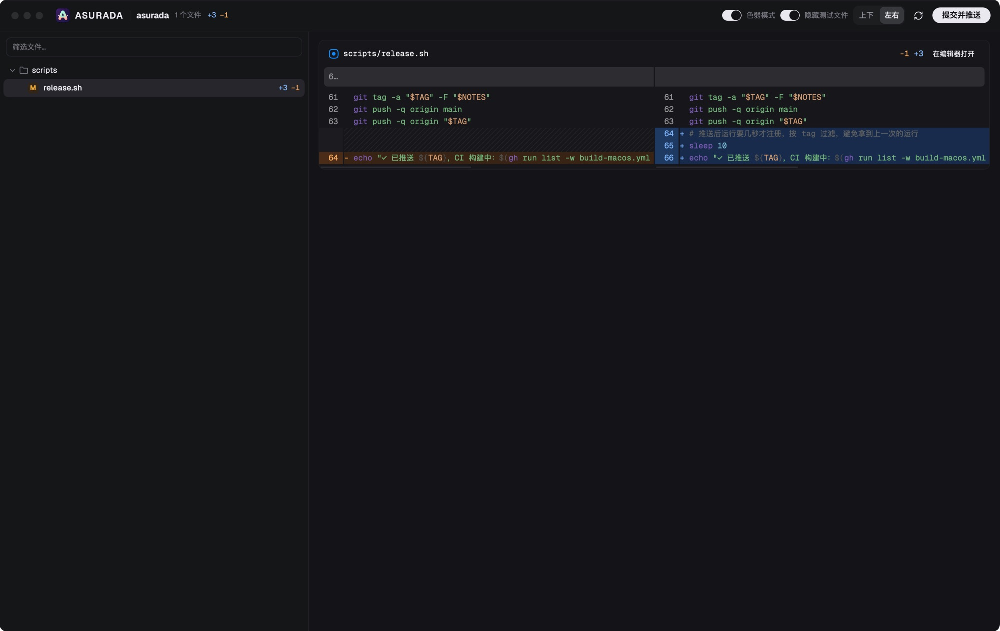

  

<h1 align="center">Asurada</h1>

  <a href="./README.md">English</a> · <a href="./README.zh-CN.md">简体中文</a> · <a href="./README.zh-TW.md">繁體中文</a> · <strong>日本語</strong> · <a href="./README.ko.md">한국어</a>

<strong>コードは AI が書く。でも、プロジェクトを理解するのはあなた。</strong>

  
  
  

Asurada は macOS の画面端にドッキングする小さなツールです。ノイズを取り除いてレビューを効率化し、複数のプロジェクトを行き来するときも快適に開発を続けられるようにします。

  
  &nbsp;
  

普段は画面端に小さなタブが見えているだけ。クリックするか、<code>Control + E</code> を押すとプロジェクトパネルが開きます。

## きっかけ

Vibe Coding でコードを書くスピードは大きく上がりました。それでもコードにはレビューが必要です。

**レビューは AI を疑うためではなく、「人」が自分のプロジェクト、特に重要な部分を把握し続けるためのものです。** コードを読まなくなると、プロジェクトは少しずつ見知らぬブラックボックスになります。問題が起きてもどこを調べればいいか分からず、判断を下すときも今どうなっているのか分からなくなります。

ところが、レビューを続けるのは簡単ではありません。

- **変更が多すぎる**：AI は 1 回で数十ファイルを変更します。すべてを読むのは現実的でなく、結局読まなくなります。
- **ノイズに埋もれる**：テストや定型コードが本題の変更に混ざり、本当に確認すべき数行が見つけにくくなります。
- **人がボトルネックになる**：複数のプロジェクトが同時に進み、どれも AI があなたのレビューを待っています。レビューは素早く終わらせたいものです。
- **レビュー後の雑務**：コミットメッセージを書き、プッシュし、コンフリクトを解決する。集中力が少しずつ削られます。

Asurada は重要な部分だけをレビューするよう導き、残りの雑務を自動で片付けます。

## できること

- **重要な部分だけをレビュー**：差分ウィンドウではテストファイルをワンクリックで非表示にでき（コミットには含まれます）、変更をディレクトリごとに並べ、行内の変更を単語単位で表示し、ファイル名で絞り込めます。注意はプロジェクトに本当に影響する部分にだけ向けられます。
- **ワンクリックでコミット＆プッシュ**：変更内容から 1 行のコミットメッセージ（例：`feat: add dark mode`）を自動で作成し、インターフェースの言語（英語／中国語）に合わせて、そのままプッシュします。リモートに新しいコミットがあれば同期して再試行し、コンフリクトがあれば元に戻して知らせるので、リポジトリが散らかりません。
- **メインの会話を汚さない**：コミットメッセージは独立した短いセッションで作成され、終わればすぐ消えます。エージェントとの会話は本来の作業だけに使えます。どのコミットも整った 1 行の説明になるので、数週間後に見返してもプロジェクトの変遷を追えます。
- **すべてのプロジェクトを一覧**：プロジェクトは 1 つのリストにまとまり、変更のあるものが上に並びます。変更のないプロジェクトを誤ってコミットすることはありません。
- **邪魔にならない常駐スタイル**：普段は画面端の小さなタブで、好きな位置にドラッグできます。コミット待ちの変更があると点灯し、折りたたみ中は小さな吹き出しでコミット結果を知らせます。
- **グローバルショートカット**：どのアプリからでも `Control + E` でパネルを開閉でき、タブを探す必要はありません。ショートカットは設定で変更できます。
- **好みに合わせて**：「コミット前に確認」をオンにしたり、ライト／ダークの外観やログイン時の自動起動を設定したりできます。
- **自動アップデート**：新しいバージョンはアプリ内で通知され、ワンクリックでインストールできます。

差分ウィンドウはあなたのレビュー台です。ノイズをしまって、大事なところを 1 行ずつ確認できます。

## こんな人に

- macOS で AI エージェントを使ってコードを書きつつ、重要な変更は自分で把握しておきたい開発者。
- 複数のローカル git リポジトリを並行して管理し、コミットとプッシュをできるだけ手軽にしたい人。

## インストール

1. [Releases](https://github.com/LuckyYunPeng/asurada/releases) から最新の `.dmg` をダウンロードします。Apple Silicon は `*_aarch64.dmg`、Intel は `*_x64.dmg` を選んでください。
2. 開いて **Asurada** を「アプリケーション」にドラッグします。
3. 初回起動時に短いガイドが表示され、実行環境が自動でチェックされます。

`git` と、コミットメッセージを作成する AI エージェントの CLI（pi、Claude Code、Codex、Grok、OpenCode、Kimi のいずれか）がインストールされている必要があります。どれを使うかは設定で選べます。Apple Silicon と Intel の Mac に対応しています。

## ライセンス

無料のオープンソースで、MIT ライセンスです。詳しくは [LICENSE](./LICENSE) をご覧ください。
