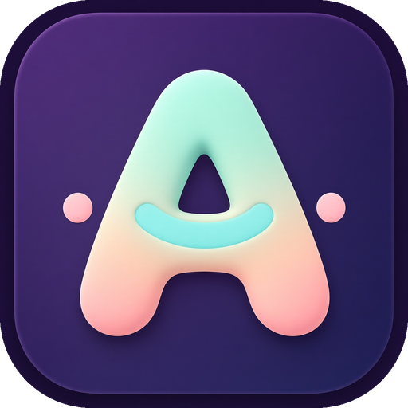
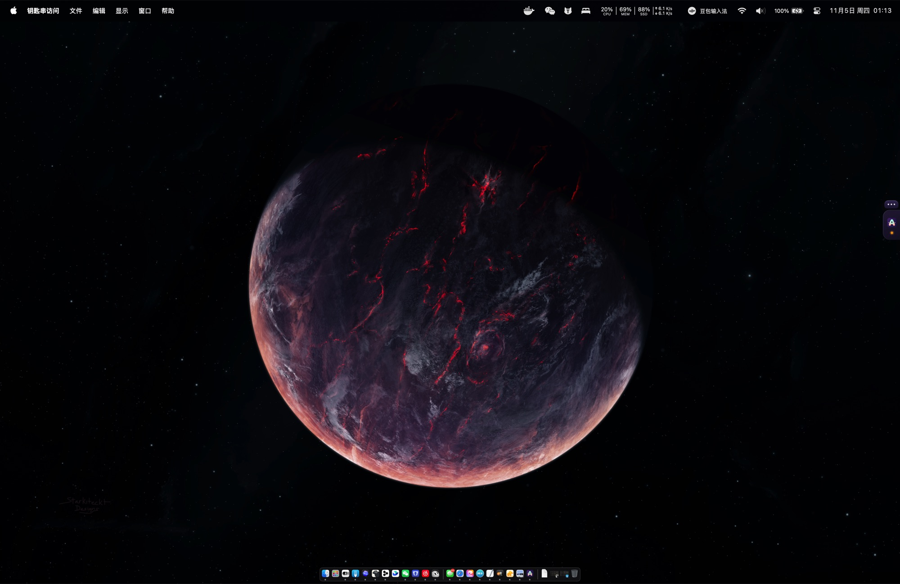
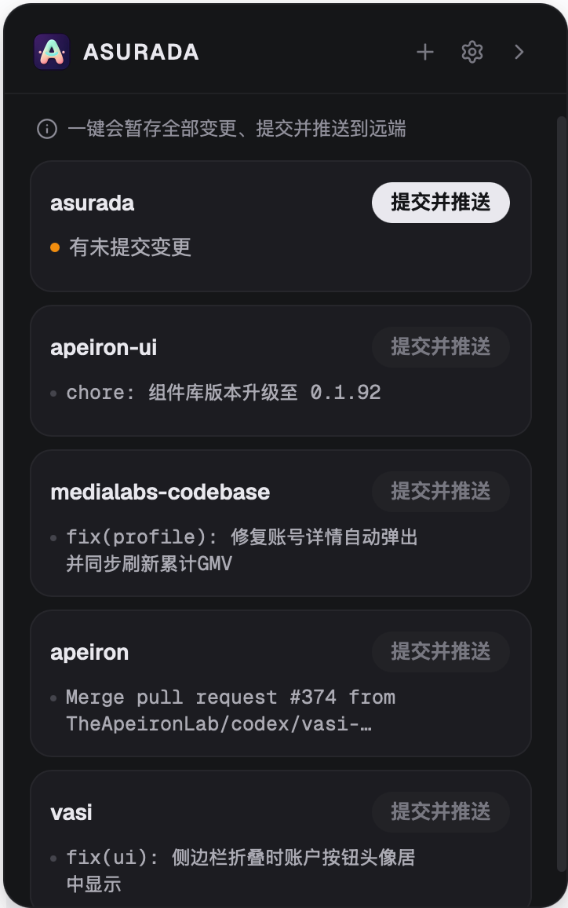
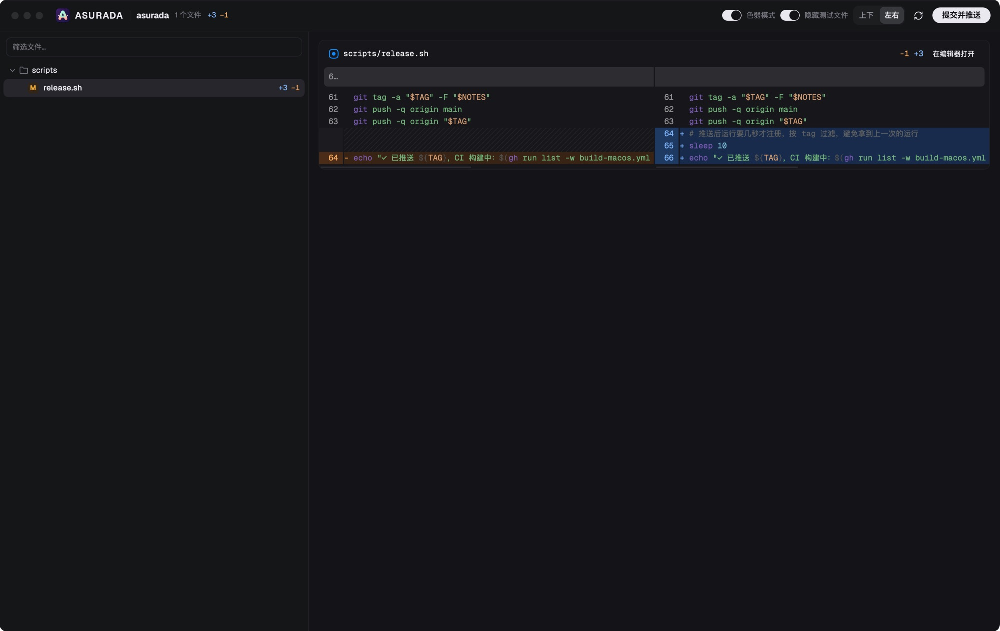

  

<h1 align="center">Asurada</h1>

  <a href="./README.md">English</a> · <a href="./README.zh-CN.md">简体中文</a> · <a href="./README.zh-TW.md">繁體中文</a> · <a href="./README.ja.md">日本語</a> · <strong>한국어</strong>

<strong>코드는 AI가 쓰더라도, 프로젝트는 당신이 이해해야 합니다.</strong>

  
  
  

Asurada는 macOS 화면 가장자리에 붙어 있는 작은 도구입니다. 노이즈를 걸러 리뷰 효율을 높이고, 여러 프로젝트를 오가며 작업할 때도 개발 흐름이 끊기지 않게 해 줍니다.

  
  &nbsp;
  

평소에는 화면 가장자리에 작은 탭만 보입니다. 탭을 클릭하거나 <code>Control + E</code>를 누르면 프로젝트 패널이 열립니다.

## 시작하게 된 이유

바이브 코딩 덕분에 코드를 쓰는 속도는 크게 빨라졌지만, 코드는 여전히 리뷰가 필요합니다.

**리뷰는 AI를 믿지 못해서가 아니라, '사람'이 자기 프로젝트, 특히 핵심적인 부분을 계속 이해하고 있기 위한 것입니다.** 코드를 더 이상 읽지 않으면 프로젝트는 점점 알아볼 수 없는 블랙박스가 됩니다. 문제가 생겨도 어디부터 봐야 할지 모르고, 결정을 내릴 때도 지금 어떤 모습인지 알 수 없습니다.

하지만 현실에서 리뷰를 꾸준히 하기는 어렵습니다.

- **변경이 너무 많음**: AI는 한 번에 수십 개 파일을 고칩니다. 한 줄씩 다 읽기는 현실적이지 않아서 결국 읽지 않게 됩니다.
- **노이즈에 묻히는 핵심**: 테스트와 보일러플레이트 코드가 실제 변경과 섞여, 정말 확인해야 할 몇 줄이 오히려 묻혀 버립니다.
- **사람이 병목이 됨**: 여러 프로젝트가 동시에 진행되고, AI는 모두 당신의 검수를 기다립니다. 프로젝트마다 리뷰는 빠르게 끝나야 합니다.
- **리뷰 뒤의 잡일**: 커밋 메시지 작성, 푸시, 충돌 해결로 집중력이 조금씩 흩어집니다.

Asurada는 핵심만 리뷰하도록 이끌고, 나머지 잡일은 알아서 처리합니다.

## 할 수 있는 일

- **핵심만 리뷰**: diff 창에서 테스트 파일을 클릭 한 번으로 숨길 수 있고(커밋에는 그대로 포함됩니다), 변경 사항을 디렉터리별로 보여 주며, 줄 안의 변경을 단어 단위로 표시하고, 파일 이름으로 필터링할 수 있습니다. 주의는 프로젝트에 실제로 영향을 주는 곳에만 쓰면 됩니다.
- **클릭 한 번으로 커밋하고 푸시**: 변경 내용으로 한 줄짜리 커밋 메시지(예: `feat: add dark mode`)를 인터페이스 언어(영어/중국어)로 자동 작성해 커밋하고 바로 푸시합니다. 원격에 새 커밋이 있으면 동기화한 뒤 다시 시도하고, 충돌이 나면 되돌리고 알려 주므로 저장소가 엉키지 않습니다.
- **메인 대화를 어지럽히지 않음**: 커밋 메시지는 별도의 짧은 세션에서 만들어지고 끝나면 바로 사라집니다. 에이전트와의 대화는 실제 작업에만 쓸 수 있습니다. 모든 커밋이 정돈된 한 줄 설명이 되므로, 몇 주 뒤에 돌아봐도 프로젝트가 어떻게 발전해 왔는지 알 수 있습니다.
- **모든 프로젝트를 한눈에**: 모든 프로젝트가 하나의 목록에 모이고, 변경 사항이 있는 프로젝트가 위에 표시됩니다. 변경 사항이 없는 프로젝트는 실수로 커밋할 수 없습니다.
- **방해하지 않는 도킹 방식**: 평소에는 화면 가장자리의 작은 탭일 뿐이며, 원하는 위치로 끌어 옮길 수 있습니다. 커밋할 변경 사항이 있으면 표시가 켜지고, 접혀 있을 때는 작은 말풍선으로 커밋 결과를 알려 줍니다.
- **전역 단축키**: 어떤 앱에서든 `Control + E`를 누르면 패널을 열고 닫을 수 있어 탭을 찾을 필요가 없습니다. 단축키는 설정에서 바꿀 수 있습니다.
- **내 방식대로**: '커밋 전 확인'을 켜거나, 라이트/다크 모드와 로그인 시 자동 실행을 설정할 수 있습니다.
- **자동 업데이트**: 새 버전이 나오면 앱 안에서 알려 주고, 클릭 한 번으로 설치합니다.

diff 창은 당신의 리뷰 데스크입니다. 노이즈는 접어 두고, 중요한 부분을 한 줄씩 살펴보세요.

## 이런 분께 추천합니다

- macOS에서 AI 에이전트로 코드를 쓰면서도 핵심 변경 사항은 직접 파악하고 싶은 개발자.
- 여러 로컬 git 저장소를 함께 관리하며, 커밋과 푸시가 최대한 간편하기를 바라는 분.

## 설치

1. [Releases](https://github.com/LuckyYunPeng/asurada/releases)에서 최신 `.dmg`를 내려받습니다.
2. 파일을 열고 **Asurada**를 '응용 프로그램' 폴더로 끌어다 놓습니다.
3. 처음 실행하면 짧은 안내가 나오고, 실행 환경을 자동으로 확인합니다.

`git`과 커밋 메시지를 작성할 AI 에이전트 CLI(pi, Claude Code, Codex, Grok, OpenCode, Kimi 중 하나)가 설치되어 있어야 합니다. 어떤 것을 쓸지는 설정에서 고를 수 있습니다. 현재는 Apple Silicon Mac만 지원합니다.

## 라이선스

무료 오픈 소스이며 MIT 라이선스를 따릅니다. 자세한 내용은 [LICENSE](./LICENSE)를 참고하세요.
