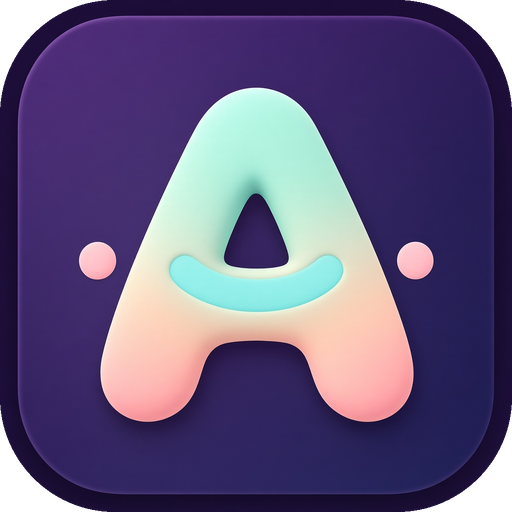
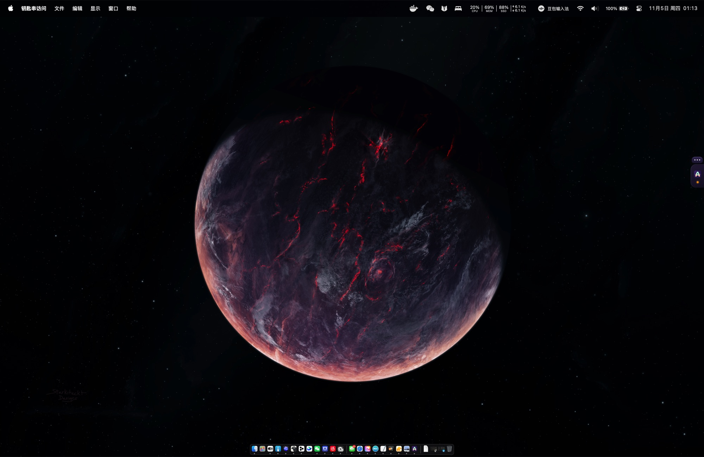
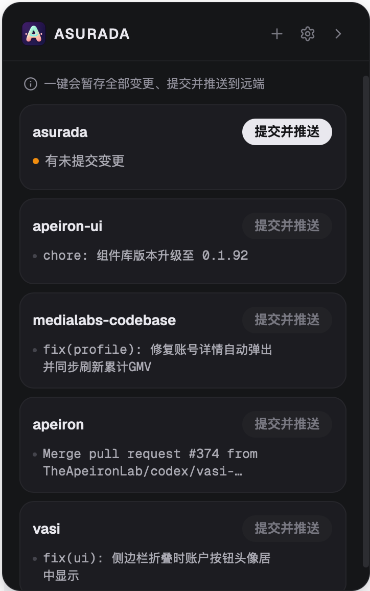
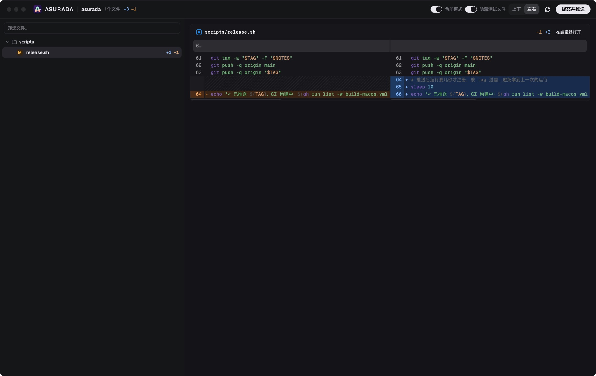

  

<h1 align="center">Asurada</h1>

  <strong>English</strong> · <a href="./README.zh-CN.md">简体中文</a> · <a href="./README.zh-TW.md">繁體中文</a> · <a href="./README.ja.md">日本語</a> · <a href="./README.ko.md">한국어</a>

<strong>Let AI write the code, but keep understanding your own project.</strong>

  
  
  

Asurada is a small tool that docks to the edge of your macOS screen. It filters out the noise so you can review code faster, and it keeps things smooth when you're jumping between several projects.

  
  &nbsp;
  

Most of the time only a small tab shows at the screen edge. Click it, or press <code>Control + E</code>, to open the project panel.

## Why

Vibe coding has made writing code much faster, but code still needs review.

**Review isn't about distrusting AI. It's about making sure you, the human, still understand your project, especially the parts that matter.** Stop reading the code and the project slowly turns into a black box you no longer recognize: when something breaks you don't know where to look, and when you need to make a call you don't know what it looks like today.

In practice, review is hard to keep up:

- **Too many changes**: one AI round can touch dozens of files. Reading every line isn't realistic, so people stop reading.
- **Noise buries what matters**: tests and boilerplate are mixed in with the real changes, and the few lines that need your judgment get lost.
- **You become the bottleneck**: several projects move at once, and the AI is waiting on your review in each. Every review should be quick in, quick out.
- **Chores after the review**: writing commit messages, pushing, resolving conflicts. Your focus gets chipped away.

Asurada steers you toward reviewing only what matters, and handles the chores for you.

## What it does

- **Review only what matters**: the diff window can hide test files in one click (they're still committed), groups changes by directory, highlights inline changes word by word, and lets you filter by file name. Your attention goes where it affects the project.
- **Commit and push in one click**: it writes a one-line commit message from your changes (such as `feat: add dark mode`) in the interface language (English or Chinese), commits, and pushes. If the remote has new commits it syncs and retries; if there's a conflict it rolls back and tells you, so your repository stays intact.
- **Keeps your main chat clean**: commit messages come from a separate short-lived session, so your agent conversation stays focused on real work. Every commit is a clean one-line description, so weeks later you can still follow how the project evolved.
- **All projects at a glance**: every project lives in one list, with changed ones on top. Projects without changes can't be committed by accident.
- **Stays out of your way**: normally just a small tab on the screen edge that you can drag where you like. It lights up when there are changes to commit, and a small bubble shows the commit result while collapsed.
- **Global shortcut**: press `Control + E` in any app to open or close the panel without hunting for the tab. You can change the shortcut in settings.
- **Your way**: turn on "Confirm before commit", and choose light or dark appearance and launch at login.
- **Automatic updates**: new versions are announced in the app and install in one click.

The diff window is your review desk: fold away the noise and read what matters line by line.

## Who it's for

- Developers on macOS who write code with AI agents but still want to stay on top of the key changes.
- Anyone maintaining several local git repositories who wants committing and pushing to be as effortless as possible.

## Install

1. Download the latest `.dmg` from [Releases](https://github.com/LuckyYunPeng/asurada/releases). Apple Silicon Macs use `*_aarch64.dmg`; Intel Macs use `*_x64.dmg`.
2. Open it and drag **Asurada** into Applications.
3. On first launch you'll see a short intro, and Asurada checks your environment automatically.

You need `git` and at least one AI agent CLI installed to write commit messages: pi, Claude Code, Codex, Grok, OpenCode, or Kimi. Pick which one in Settings. Apple Silicon and Intel Macs are both supported.

## License

Free and open source under the MIT License. See [LICENSE](./LICENSE).
