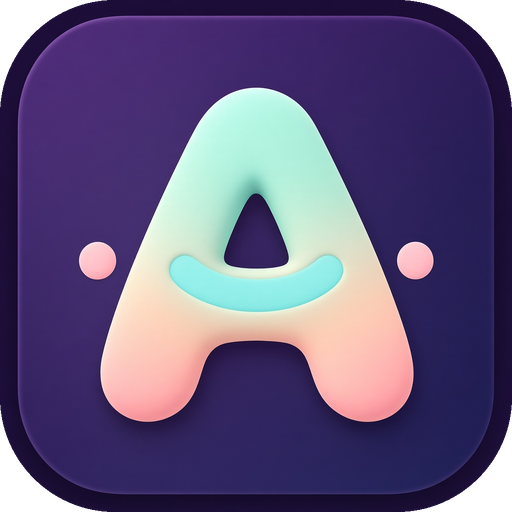
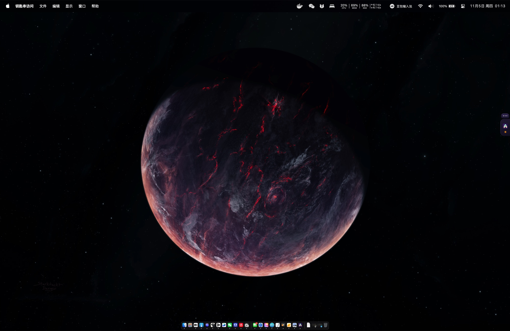
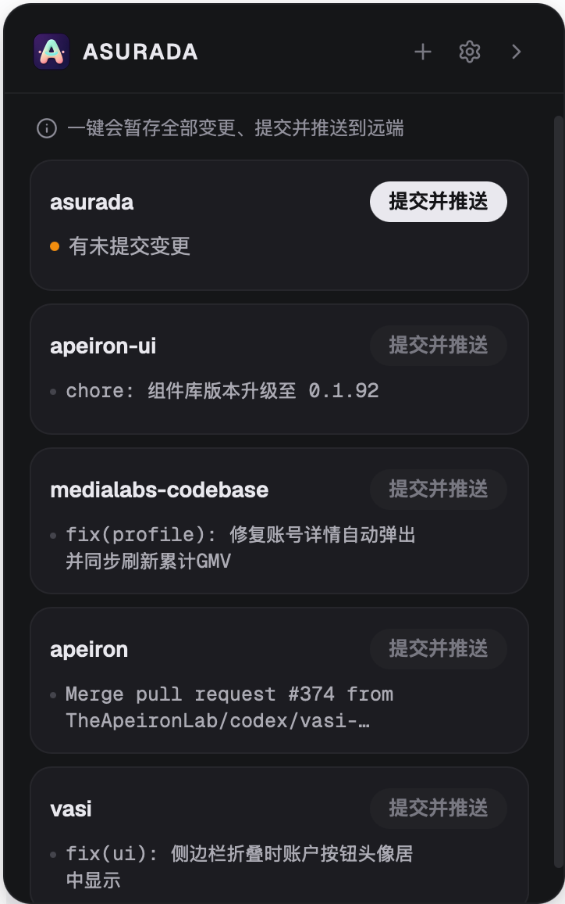
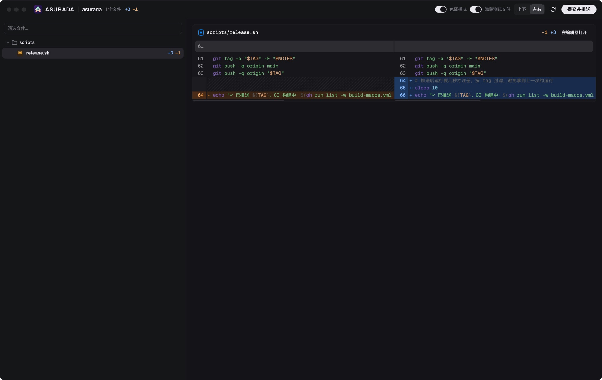

  

<h1 align="center">Asurada</h1>

  <a href="./README.md">English</a> · <strong>简体中文</strong> · <a href="./README.zh-TW.md">繁體中文</a> · <a href="./README.ja.md">日本語</a> · <a href="./README.ko.md">한국어</a>

<strong>AI 写代码，但你得看懂自己的项目。</strong>

  
  

Asurada 是一个停靠在 macOS 屏幕边缘的小工具。Asurada 的出发点是帮你滤掉噪音，提高你的 Review 效率，尤其是在多个项目之间穿插时，开发体验更加丝滑。

  
  &nbsp;
  

平时只在屏幕边缘露出一个小标签；点击它，或按快捷键 <code>Control + E</code>，即可展开项目面板。

## 出发点

Vibe Coding 让写代码快了很多，但代码依然需要 Review。

**Review 不是因为不信任 AI，而是为了让「人」始终了解自己的项目，尤其是那些关键的地方。** 如果不再看代码，项目会慢慢变成一个你不认识的黑盒：出了问题不知道从哪里查，做决定时不知道它现在长什么样。

可现实中的 Review 很难坚持：

- **改动太多**：AI 一轮就能改几十个文件，逐行看完不现实，于是干脆不看。
- **噪音淹没重点**：测试和样板代码混在业务改动里，真正需要你把关的那几行反而被埋掉。
- **人成了流程的瓶颈**：多个项目同时推进，AI 都在等你验收。每个项目的 Review 都该快进快出。
- **看完还有杂事**：写提交信息、推送、处理冲突，专注力被一点点打散。

Asurada 引导你只 Review 重点，把剩下的杂事自动做完。

## 能做什么

- **只 Review 重点**：差异窗口可以一键隐藏测试文件（提交时照常带上），变更按目录排开，行内改动精确到词，还能按文件名筛选。注意力只花在真正影响项目的地方。
- **一键提交并推送**：根据本次改动自动生成一行提交信息（如 `feat: 新增深色模式`），语言跟随界面（中文 / 英文），提交后直接推送。远端有新提交时自动同步后重试；有冲突就撤回并提示，不会弄乱你的仓库。
- **不占主对话上下文**：提交信息由独立的短会话生成，交完就散，你的 Agent 对话只留给真正的工作。每次提交都是一行规范的描述，几周后回头翻，也能看懂项目是怎么一步步演进的。
- **多项目一览**：所有项目集中在一个列表，有改动的排在前面；没有改动的项目不能误点提交。
- **不打扰的停靠方式**：平时只是屏幕边缘的一个小标签，可以拖到合适的位置；有待提交的改动时会亮起提示，收起后用小气泡告诉你提交结果。
- **全局快捷键**：在任何应用里按 `Control + E` 都能展开或收起面板，不用去找标签；快捷键可以在设置里修改。
- **按你的习惯来**：可以开启「提交前确认」，也可以设置浅色/深色外观和开机自启动。
- **自动更新**：有新版本时在应用内提示，一键安装。

差异窗口就是你的 Review 台，噪音收起来，重点逐行看：

## 适合谁

- 在 macOS 上用 AI Agent 写代码，但仍想把握项目关键改动的开发者。
- 同时维护多个本地 git 仓库，希望提交推送越省事越好的人。

## 安装

1. 从 [Releases](https://github.com/LuckyYunPeng/asurada/releases) 下载最新的 `.dmg`。
2. 打开后把 **Asurada** 拖进「应用程序」。
3. 首次打开会有简短引导，并自动检查运行环境。

使用前需要本机已安装 `git` 和 `pi`（用来生成提交信息）。目前仅支持 Apple Silicon 的 Mac。

## 许可证

免费、开源，MIT 协议，见 [LICENSE](./LICENSE)。
