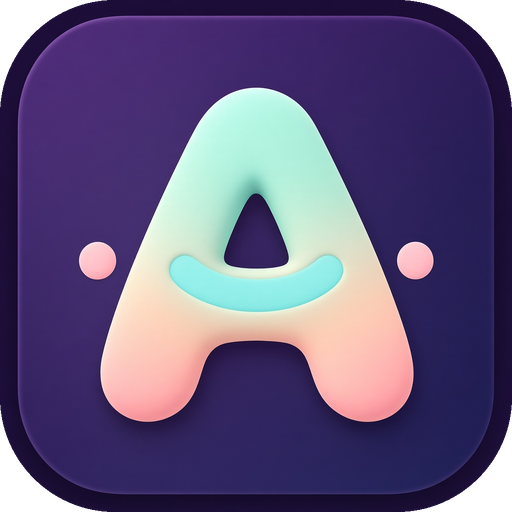
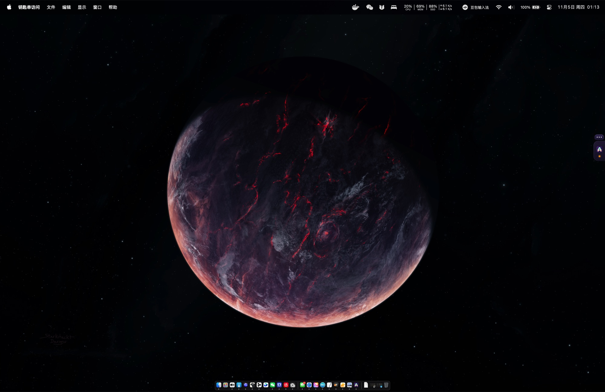
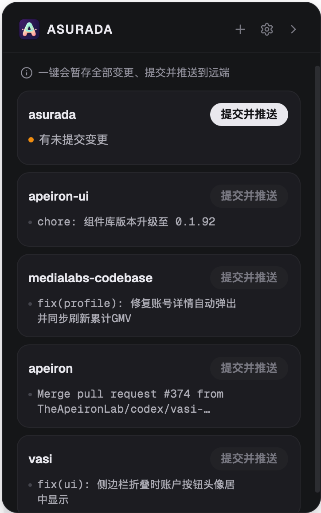
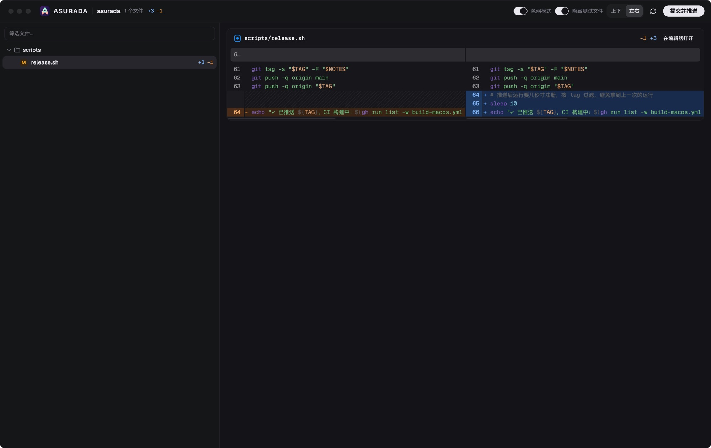

  

<h1 align="center">Asurada</h1>

  <a href="./README.md">English</a> · <a href="./README.zh-CN.md">简体中文</a> · <strong>繁體中文</strong> · <a href="./README.ja.md">日本語</a> · <a href="./README.ko.md">한국어</a>

<strong>AI 寫程式，但你得看懂自己的專案。</strong>

  
  
  

Asurada 是一個停靠在 macOS 螢幕邊緣的小工具。它的出發點是幫你濾掉雜訊，提高 Review 的效率，尤其在多個專案之間穿梭時，開發體驗更加流暢。

  
  &nbsp;
  

平時只在螢幕邊緣露出一個小標籤；點擊它，或按快捷鍵 <code>Control + E</code>，即可展開專案面板。

## 出發點

Vibe Coding 讓寫程式快了很多，但程式碼依然需要 Review。

**Review 不是因為不信任 AI，而是為了讓「人」始終了解自己的專案，尤其是那些關鍵的地方。** 如果不再看程式碼，專案會慢慢變成一個你不認識的黑盒子：出了問題不知道從哪裡查，做決定時不知道它現在長什麼樣。

可現實中的 Review 很難堅持：

- **變更太多**：AI 一輪就能改幾十個檔案，逐行看完不切實際，於是乾脆不看。
- **雜訊淹沒重點**：測試和樣板程式碼混在業務變更裡，真正需要你把關的那幾行反而被埋沒。
- **人成了流程的瓶頸**：多個專案同時推進，AI 都在等你驗收。每個專案的 Review 都該快進快出。
- **看完還有雜事**：寫提交訊息、推送、處理衝突，專注力被一點點打散。

Asurada 引導你只 Review 重點，把剩下的雜事自動做完。

## 能做什麼

- **只 Review 重點**：差異視窗可以一鍵隱藏測試檔案（提交時照常帶上），變更按目錄排列，行內變更精確到詞，還能按檔名篩選。注意力只花在真正影響專案的地方。
- **一鍵提交並推送**：根據本次變更自動產生一行提交訊息（如 `feat: 新增深色模式`），語言跟隨介面（中文／英文），提交後直接推送。遠端有新提交時自動同步後重試；有衝突就撤回並提示，不會弄亂你的儲存庫。
- **不佔用主對話的上下文**：提交訊息由獨立的短會話產生，交完就散，你的 Agent 對話只留給真正的工作。每次提交都是一行規範的描述，幾週後回頭翻，也能看懂專案是怎麼一步步演進的。
- **多專案一覽**：所有專案集中在一個列表，有變更的排在前面；沒有變更的專案不會被誤點提交。
- **不打擾的停靠方式**：平時只是螢幕邊緣的一個小標籤，可以拖到合適的位置；有待提交的變更時會亮起提示，收合後用小氣泡告訴你提交結果。
- **全域快捷鍵**：在任何應用程式裡按 `Control + E` 都能展開或收合面板，不用去找標籤；快捷鍵可以在設定裡修改。
- **照你的習慣來**：可以開啟「提交前確認」，也可以設定淺色／深色外觀和開機自動啟動。
- **自動更新**：有新版本時在應用程式內提示，一鍵安裝。

差異視窗就是你的 Review 台，雜訊收起來，重點逐行看：

## 適合誰

- 在 macOS 上用 AI Agent 寫程式，但仍想掌握專案關鍵變更的開發者。
- 同時維護多個本機 git 儲存庫，希望提交推送越省事越好的人。

## 安裝

1. 從 [Releases](https://github.com/LuckyYunPeng/asurada/releases) 下載最新的 `.dmg`。
2. 開啟後把 **Asurada** 拖進「應用程式」。
3. 首次開啟會有簡短引導，並自動檢查執行環境。

使用前需要本機已安裝 `git`，以及任一 AI Agent 命令列工具（用來產生提交訊息）：pi、Claude Code、Codex、Grok、OpenCode 或 Kimi，可在設定中選擇使用哪一個。目前僅支援 Apple Silicon 的 Mac。

## 授權

免費、開源，MIT 授權，見 [LICENSE](./LICENSE)。
